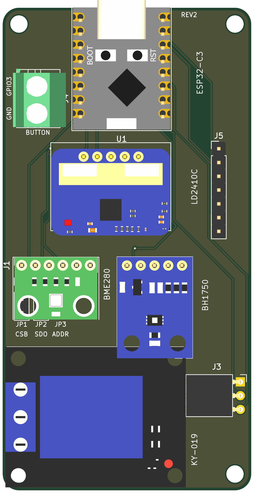

# ESP32-C3 Sensor Carrier Board

Wall-mountable carrier for an **ESP32-C3 Super Mini** that exposes the module's GPIO, power and
comms for plug-in sensor and peripheral modules. Hardware only — the ESPHome configuration lives
in a separate project (`doorbell.yml` is the authoritative pin/feature map).

Current board: **rev2, 46 × 89 mm**, 2-layer, USB-C on the top short edge.



## Modules

| Function | Module | Interface | Address / settings |
|---|---|---|---|
| Temperature, humidity, pressure | BME280 (BME680 variant) | I²C, 1×6 socket | 0x76 (SDO → GND) |
| Illuminance | BH1750 (GY-302) | I²C, 1×5 socket | 0x23 (ADDR → GND) |
| Presence | HLK-LD2410C | UART, 1×5 socket | 256000 baud, 8N1 |
| Relay | KY-019 class | 1×3 right-angle socket | 5 V, active-high signal |
| Button | wire terminal | 2-pin screw terminal | to GND, internal pull-up |

Female sockets are fitted on the carrier; the modules carry male pins. Relay and button remain
screw/plug connections.

## Pin map (rev2)

| Function | ESP32-C3 pin | Net | Where |
|---|---|---|---|
| Relay control | GPIO4 | RELAY | J3 pin 3 |
| Button | GPIO3 | BUTTON | J4 pin 1 |
| I²C SDA | GPIO8 | I2C_SDA | J1/J2 + breakout |
| I²C SCL | GPIO9 | I2C_SCL | J1/J2 + breakout |
| LD2410C RX (module TX) | GPIO20 | UART_RX | U2 pin 1 |
| LD2410C TX (module RX) | GPIO21 | UART_TX | U2 pin 2 |
| SPI CS (jumper option) | GPIO7 | SPI_CS | JP1 pin 3 + breakout |
| SPI MISO (jumper option) | GPIO5 | SPI_MISO | JP2 pin 3 + breakout |
| SPI SCK / MOSI (SPI mode) | GPIO9 / GPIO8 | I2C_SCL / I2C_SDA | BME280 SCL/SDA — shared with I²C |

GPIO18/19 are the native USB pins and are left free for flashing/logging.

## Breakout row (J5, 1×14 holes)

`3V3 · 5V · GND · GPIO0 · GPIO1 · GPIO2 · GPIO5 · GPIO6 · GPIO7 · GPIO10 · SDA · SCL · RX · TX`

I²C and UART are on the row by net name, so a second device can share the buses. I²C uses GPIO8/9,
which are also C3 strapping pins (GPIO9 = BOOT, GPIO8 = LED on most Super Minis); the module-side
I²C pull-ups hold both high at reset, which is the required state. GPIO0/GPIO2 are the other
strapping pins — usable as taps, but do not hold them low at reset. GPIO8 drives the onboard LED
as well, so expect faint LED activity during I²C traffic.

## Jumpers (2.54 mm headers, shunt-selectable)

| Ref | Pins | Default (doorbell.yml) | Function |
|---|---|---|---|
| JP1 | 1×3 | **1–2** | 1=3V3, 2=BME CSB, 3=SPI_CS (GPIO7) → 1–2 = I²C, 2–3 = SPI |
| JP2 | 1×3 | **1–2** | 1=GND, 2=BME SDO, 3=SPI_MISO (GPIO5) → 1–2 = 0x76, 2–3 = SPI MISO |
| JP3 | 1×2 | **1–2** | GND–ADDR → 0x23 (open = 0x5C) |

JP1/JP2 sit under the BME280 socket (≈6 mm clearance); the default-bridged pairs are boxed on
the bottom silkscreen and the full descriptions are printed on the back.

## Variants / roadmap

| Variant | Size | Relay | Sensor | GPIO4 | Status |
|---|---|---|---|---|---|
| [relay-bme280](docs/variants/relay-bme280.md) | 46 × 89 | yes | BME280 | relay | **built** |
| [relay-bme680](docs/variants/relay-bme680.md) | 46 × 89 | yes | BME680 | relay | planned |
| [compact-bme280](docs/variants/compact-bme280.md) | 46 × 68 | no | BME280 | breakout | planned |
| [compact-bme680](docs/variants/compact-bme680.md) | 46 × 68 | no | BME680 | breakout | planned |

The compact variants drop J3 and the relay-module footprint, shorten the board, and add GPIO4 to
the breakout row (15 holes).

## Documentation

- [Pin map and connectors](docs/pinout.md)
- [Bill of materials](docs/BOM.csv)
- [Cost estimate — bare vs populated](docs/pricing.md) (script: `tools/aisler_quote.py`)
- [Generated HTML page](docs/index.html) (GitHub Pages ready)
- Variant pages under [`docs/variants/`](docs/variants/)

## Repository layout

```
hardware/                 KiCad 10 project (rev2), libraries, 3D models
docs/                     documentation, BOM, HTML page
doorbell.yml              authoritative ESPHome configuration
CLAUDE.md / HANDOFF.md    design brief and working notes
```

## Ordering

- 2-layer, 1.6 mm FR4, 0.15 mm minimum trace, 0.2 mm clearance, ENIG preferred (castellated
  nothing — all standard PTH).
- Assembly is hand-solder: sockets, terminals, jumper headers, breakout row.
- Do not fit metal-filled or carbon filament anywhere in front of the radar or light sensor.

## Licence

Hardware design files: CERN-OHL-P-2.0 (proposed). Documentation: CC BY-SA 4.0.
